

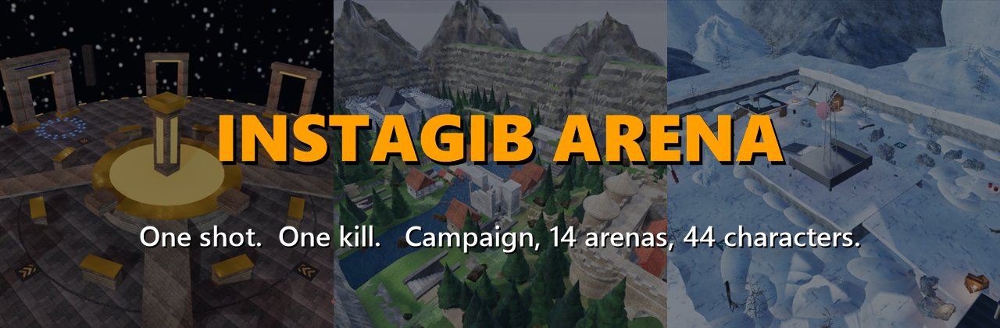

### A fast, free first-person arena shooter for Windows.
One weapon. One hit. One kill. Play alone against bots, or with your friends.

**Free · Windows 10 or 11 · about 747 MB · no account needed**

[Step-by-step guide with pictures](https://eladozcohen.github.io/InstagibArena/) · [עברית](#עברית) · [All versions](../../releases) · [Report a problem](../../issues/new)

---

## Install in 4 steps (takes two minutes)

**The arenas** (all 14, from industrial yards to a stone disc beside a black hole):

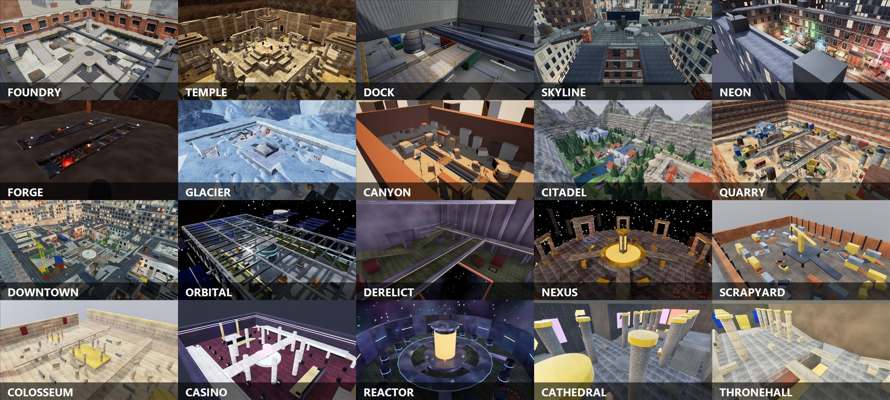

| | |
|---|---|
| 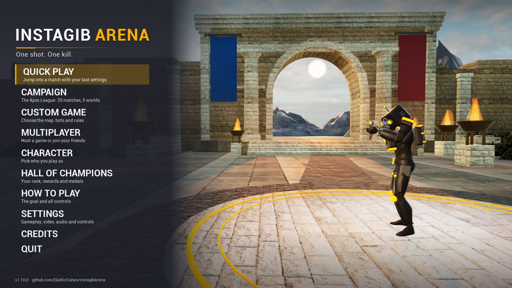 | 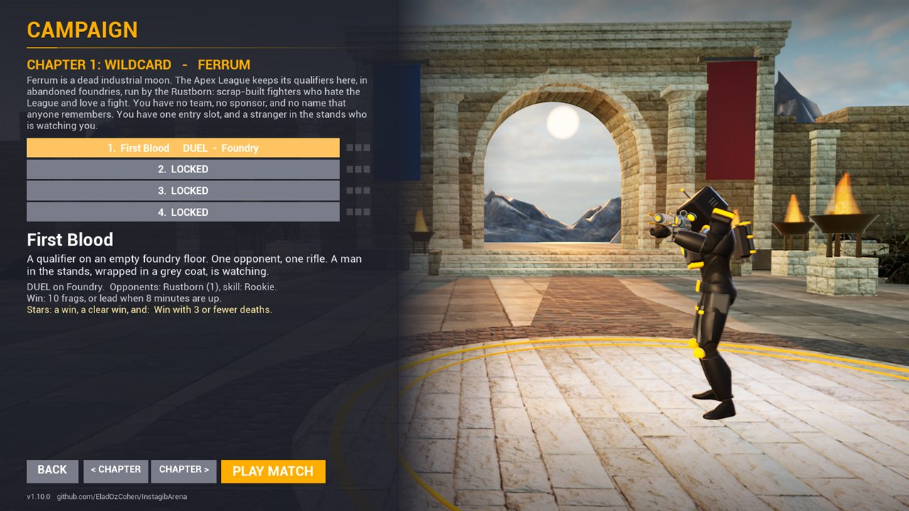 |
| 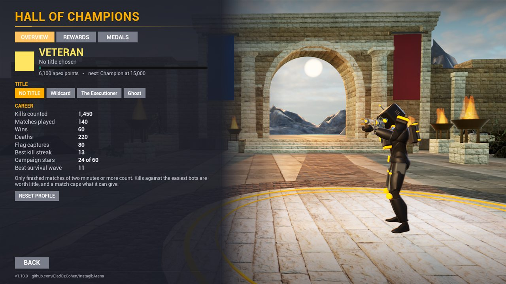 | 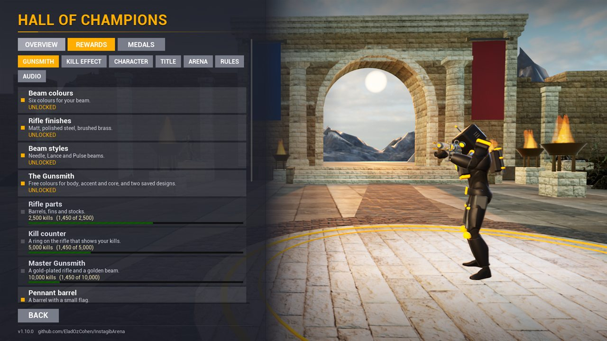 |
| 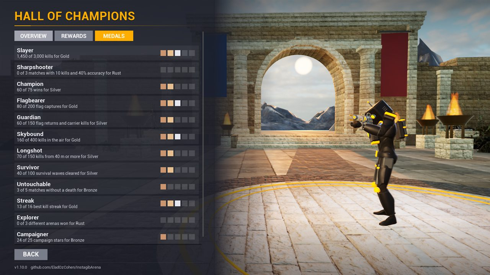 | 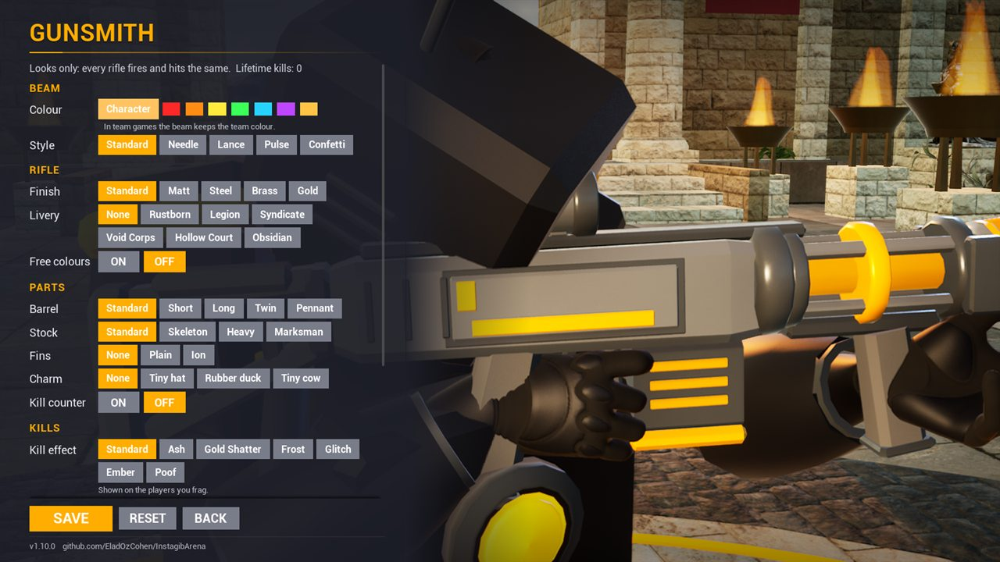 |
| 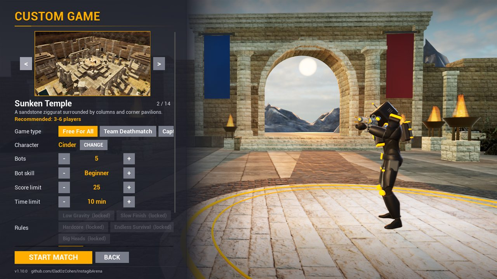 | 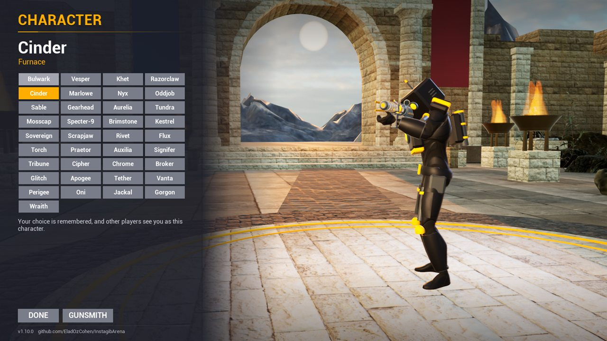 |
| 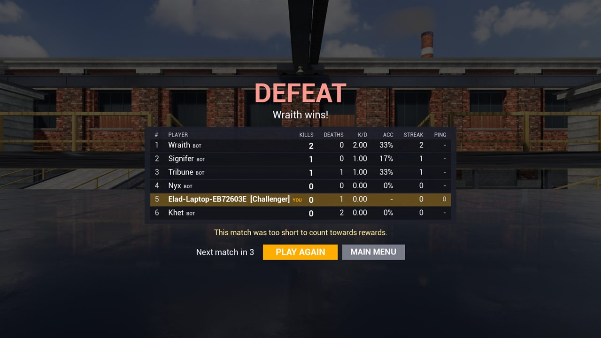 | |

**Characters** (a few of the 44, in the in-game showroom):

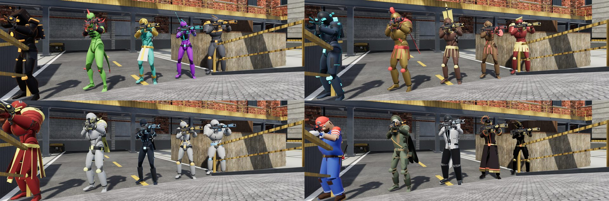

## Playing with friends

Everyone needs the game installed. One person hosts, the others join.

- **Host:** main menu > **Multiplayer** > **Host a game** > **Host game**. The screen shows an **address** (like `192.168.1.20`). Tell it to your friends, or press **Copy address**.
- **Everyone else:** **Multiplayer** > **Join a game**, type the host's address, press **Join game**.
- **Same home network (Wi-Fi)?** That is all you need. **Friends in other places?** The easiest way is for everyone to install the free
  [Tailscale](https://tailscale.com/) or [ZeroTier](https://www.zerotier.com/), join the same virtual network, and use the host's address there.
  Or the host forwards UDP port **7777** on their router.

## Controls

You can change every key in *Settings* > *Controls*.

| Key | Action |
|---|---|
| W A S D | Move |
| Mouse | Look |
| Left mouse button | Fire (one hit kills) |
| Space | Jump (press twice for a double jump) |
| Double-tap W / A / S / D | Dodge |
| Dodge next to a wall in the air | Wall dodge |
| Left Ctrl (hold) | Crouch |
| Left Shift (hold) | Slow walk (quiet and precise) |
| Tab | Scoreboard |
| Esc | Pause menu (resume, settings, leave the match, quit). In the main menu: back one screen |

---

## עברית

**Instagib Arena** הוא משחק יריות מהיר וחינמי בגוף ראשון ל-Windows. נשק אחד, פגיעה אחת, הריגה אחת.
משחקים לבד נגד בוטים או עם חברים.

### איך מתקינים (שתי דקות)
1. לוחצים על הכפתור הכתום **Download for Windows** בראש הדף. קובץ בשם `InstagibArena_Setup.exe` נשמר במחשב (אם הדפדפן שואל, בוחרים **Keep**).
2. פותחים את הקובץ (בתיקיית **הורדות**). **סביר ש-Windows יציג מסך כחול** עם הכיתוב *"Windows protected your PC"*. זה רגיל.
   לוחצים **More info** ואז **Run anyway**. אם הוא שואל אם לאפשר שינויים, לוחצים **Yes**.
3. עוברים על אשף ההתקנה: בוחרים שפה (עברית או אנגלית), לוחצים **Next** עד **Install**. הוא מתקין לבד כל מה שהמשחק צריך. לא צריך Unreal Engine או שום דבר אחר.
4. מפעילים את **Instagib Arena** מהסמל בשולחן העבודה ולוחצים **QUICK PLAY**.

**למה המסך הכחול? זה בטוח?** Windows מציג אותו לכל תוכנה חדשה של מפתח קטן שעוד לא שילם על חתימה דיגיטלית. כל המשחק בקוד פתוח,
וכל אחד יכול לקרוא בדיוק מה הוא עושה, ממש כאן במאגר. אם אתה מעדיף לא להריץ, פשוט אל תתקין.

### משחק עם חברים
אחד פותח משחק: **Multiplayer** > **Host a game** > **Host game**, ואומר לחברים את הכתובת שמופיעה.
החברים: **Multiplayer** > **Join a game**, מקלידים את הכתובת ולוחצים **Join game**. באותה רשת Wi-Fi זה כל מה שצריך.
במקומות שונים מתקינים כולם את [Tailscale](https://tailscale.com/) החינמי.

---

**[For developers: build the game, tools and project layout](docs/DEVELOPERS.md)** · [Development guide](docs/DEVELOPMENT.md)

## Credits and licenses

- Game code, tools and generated audio: MIT, see [LICENSE](LICENSE). More in [NOTICE.md](NOTICE.md).
- Built with Unreal Engine 5.8 by Epic Games. The Mannequin characters and animations are Epic's content and are not stored in this repository.
- Textures and 3D props (rocks, trees, barrels and more) are free CC0 assets from [Poly Haven](https://polyhaven.com/) and [ambientCG](https://ambientcg.com/), each one listed in [NOTICE.md](NOTICE.md).
- Sounds and music are generated from scratch by the tools in this repository, not sampled from anything.
