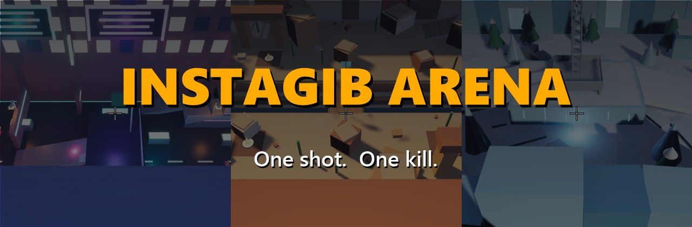
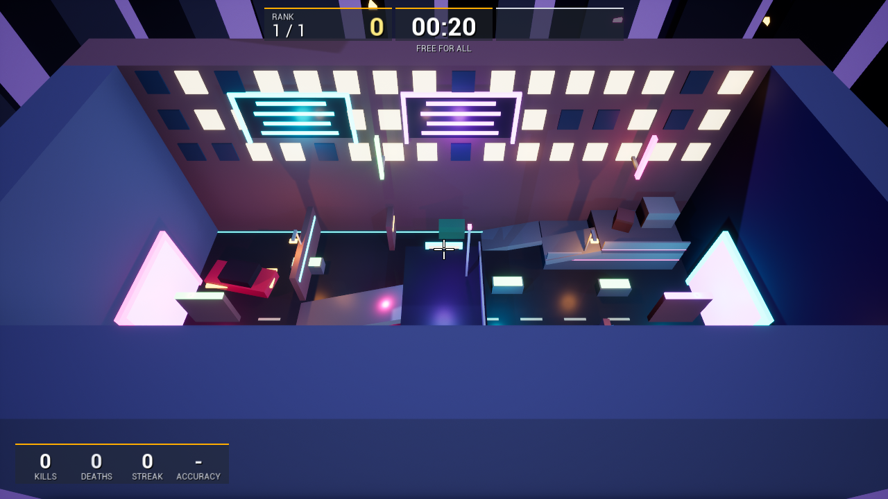
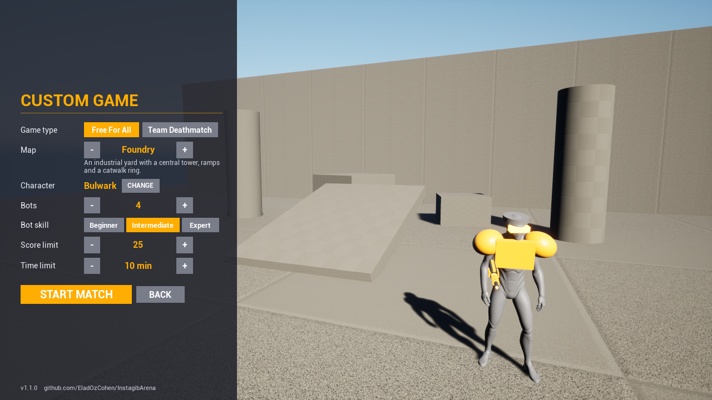
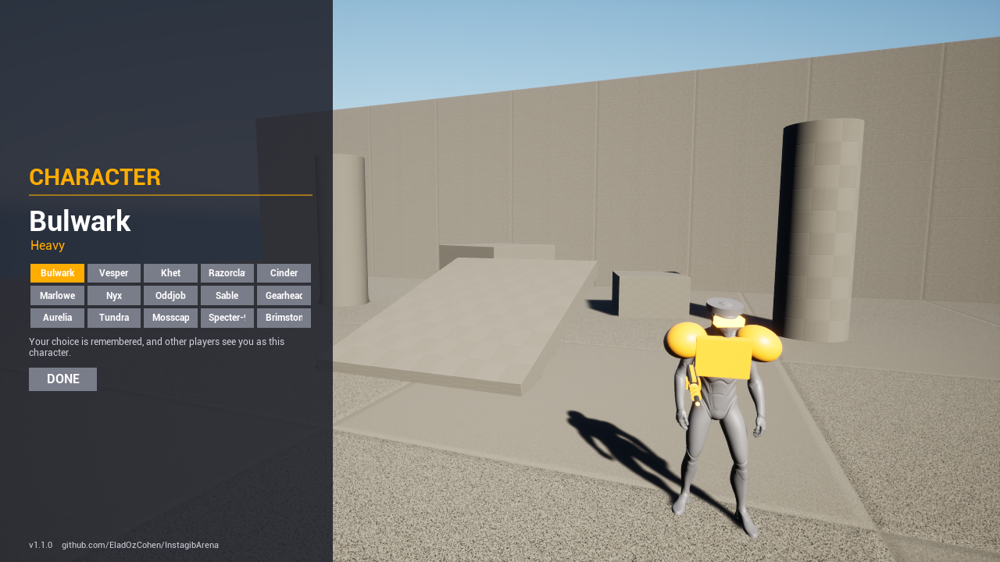
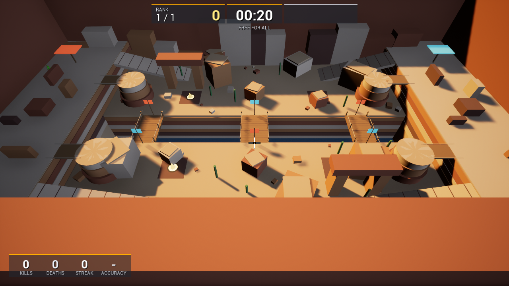
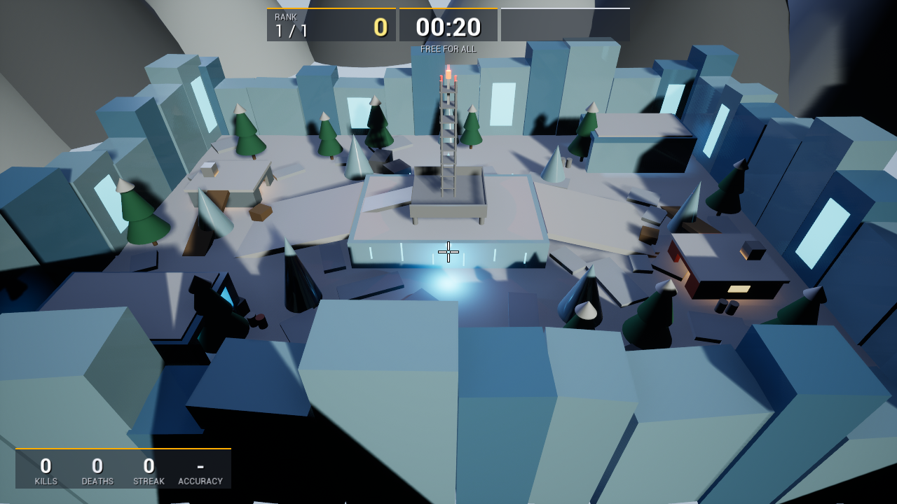
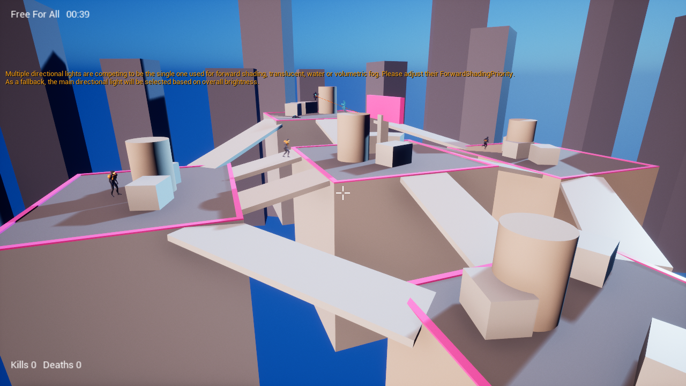
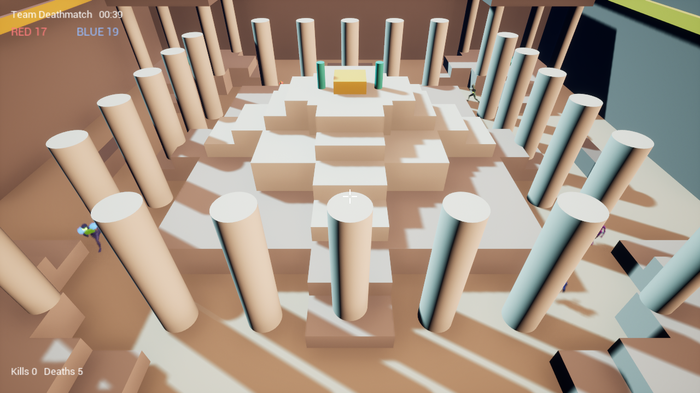
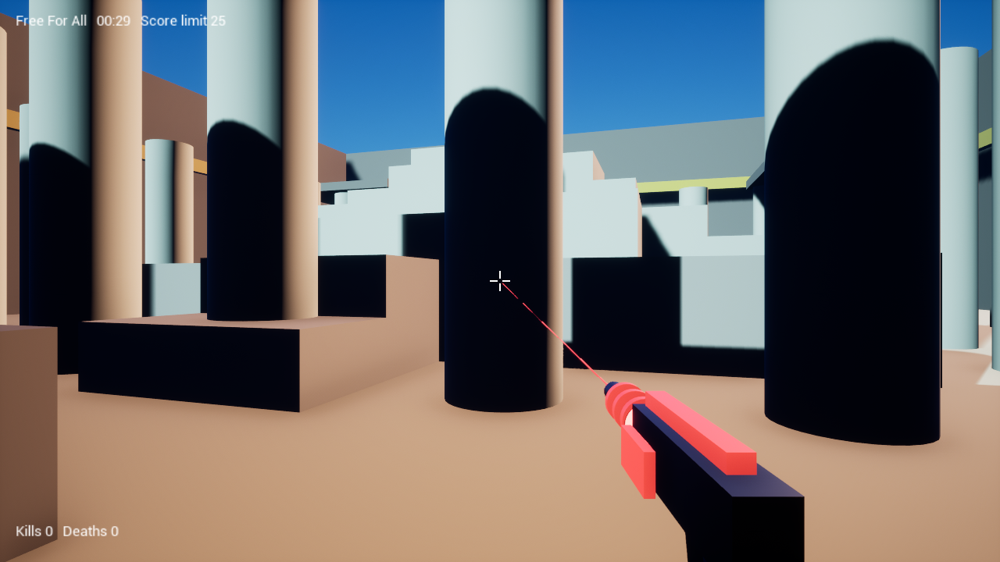
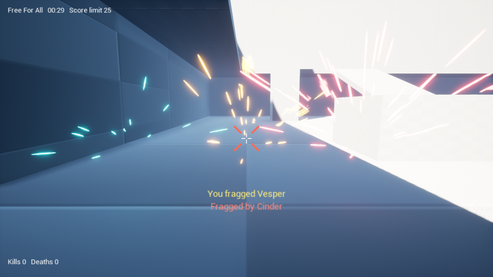

### A fast, free first-person arena shooter for Windows.
One weapon. One hit. One kill. Play alone against bots, or with your friends.

**Free · Windows 10 or 11 · about 316 MB · no account needed**

[Step-by-step guide with pictures](https://eladozcohen.github.io/InstagibArena/) · [עברית](#עברית) · [All versions](../../releases) · [Report a problem](../../issues/new)

---

## Install in 4 steps (takes two minutes)

| | |
|---|---|
| **1** | **Click the orange Download button above.** A file called `InstagibArena_Setup.exe` is saved on your computer. If your browser asks, choose **Keep**. |
| **2** | **Open the file** (it is in your *Downloads* folder). **Windows will probably show a blue screen** that says *"Windows protected your PC"*. That is normal. Click **More info**, then **Run anyway**. If it asks "Do you want to allow this app to make changes?", click **Yes**. |
| **3** | **Follow the installer.** Choose a language and keep pressing **Next**, then **Install**. It adds everything the game needs. You do not need Unreal Engine or anything else. |
| **4** | **Play.** Start **Instagib Arena** from the desktop icon or the Start menu, and press **QUICK PLAY**. |

> **Why the blue screen? Is it safe?** Windows shows it for every new program from a small developer that has not paid
> for a digital signature (it costs money every year). The whole game is open source, so anyone can read exactly what it
> does, right here in this repository. If you would rather not run it, simply do not install it.

<b>Something went wrong? Quick answers</b>

- **The game is slow or choppy:** *Settings* > *Video*: lower **Quality** or the resolution, and turn **Motion blur** off. Plug in a laptop.
- **My friends cannot join my game:** everyone needs the same version. The host should keep the *Windows Firewall* box ticked during installation. Type the address exactly as shown. Same Wi-Fi is easiest; for different places use the free [Tailscale](https://tailscale.com/).
- **How do I remove it?** Windows *Settings* > *Apps* > *Instagib Arena* > *Uninstall*.
- **Mac or phone?** Not yet. Windows PCs only.
- **Anything else:** [open an issue](../../issues/new) and say what happened.

---

## What is in the game

- **8 maps:** Foundry (industrial yard), Sunken Temple, Orbital Dock, Skyline (rooftops, falling kills), **Neon Street** (night city duel),
  **Forge** (lava hall), **Glacier** (ice outpost) and **Canyon** (huge, with rope bridges). **Jump pads** launch you to the high ground.
- **Instagib rifle:** hitscan, one hit kills. Glowing beams, spark bursts, a hit marker and kill messages.
- **Fast, fluid movement:** double jump, dodge (double-tap a direction), wall dodge, crouch and a slow walk. A smooth camera
  with head bob, a lean when strafing and a dip on landing (each can be switched off).
- **Animated characters:** walking and running in eight directions, jump, fall and crouch poses, the rifle in the hands,
  and a body that collapses when it is hit. Scorch marks stay on walls and floors.
- **A complete match:** 5 second warm-up with a 3-2-1 countdown, live play, a results screen (rank, kills, deaths, accuracy,
  best streak) and a quick rematch. Medals for first blood, multi-kills and killing sprees, a kill feed, and a short protection after you respawn.
- **Free for all** and **team deathmatch** (red vs blue), with a score limit, a time limit, or both.
- **Bots** (2 to 10) at three skill levels: beginner, intermediate and expert.
- **15 characters** with their own looks, picked in a menu with a live 3D preview.
- **Online multiplayer** with friends: one hosts, the others join with an address.
- **Sound and music:** footsteps, weapons, hit feedback and three music tracks, with volume settings.
- **Proper menus:** Quick Play, Custom Game (with a picture and a recommended player count for every map), Multiplayer, Character,
  How to Play, Settings in tabs (gameplay, video, audio and controls with **rebindable keys**, four crosshair styles) and a pause menu.
  Everything works with the mouse and the keyboard.

| | |
|---|---|
|  |  |
|  |  |
|  |  |
|  |  |

## Playing with friends

Everyone needs the game installed. One person hosts, the others join.

- **Host:** main menu > **Multiplayer** > **Host a game** > **Host game**. The screen shows an **address** (like `192.168.1.20`). Tell it to your friends, or press **Copy address**.
- **Everyone else:** **Multiplayer** > **Join a game**, type the host's address, press **Join game**.
- **Same home network (Wi-Fi)?** That is all you need. **Friends in other places?** The easiest way is for everyone to install the free
  [Tailscale](https://tailscale.com/) or [ZeroTier](https://www.zerotier.com/), join the same virtual network, and use the host's address there.
  Or the host forwards UDP port **7777** on their router.

## Controls

You can change every key in *Settings* > *Controls*.

| Key | Action |
|---|---|
| W A S D | Move |
| Mouse | Look |
| Left mouse button | Fire (one hit kills) |
| Space | Jump (press twice for a double jump) |
| Double-tap W / A / S / D | Dodge |
| Dodge next to a wall in the air | Wall dodge |
| Left Ctrl (hold) | Crouch |
| Left Shift (hold) | Slow walk (quiet and precise) |
| Tab | Scoreboard |
| Esc | Pause menu (resume, settings, leave the match, quit). In the main menu: back one screen |

---

## עברית

**Instagib Arena** הוא משחק יריות מהיר וחינמי בגוף ראשון ל-Windows. נשק אחד, פגיעה אחת, הריגה אחת.
משחקים לבד נגד בוטים או עם חברים.

### איך מתקינים (שתי דקות)
1. לוחצים על הכפתור הכתום **Download for Windows** בראש הדף. קובץ בשם `InstagibArena_Setup.exe` נשמר במחשב (אם הדפדפן שואל, בוחרים **Keep**).
2. פותחים את הקובץ (בתיקיית **הורדות**). **סביר ש-Windows יציג מסך כחול** עם הכיתוב *"Windows protected your PC"*. זה רגיל.
   לוחצים **More info** ואז **Run anyway**. אם הוא שואל אם לאפשר שינויים, לוחצים **Yes**.
3. עוברים על אשף ההתקנה: בוחרים שפה (עברית או אנגלית), לוחצים **Next** עד **Install**. הוא מתקין לבד כל מה שהמשחק צריך. לא צריך Unreal Engine או שום דבר אחר.
4. מפעילים את **Instagib Arena** מהסמל בשולחן העבודה ולוחצים **QUICK PLAY**.

**למה המסך הכחול? זה בטוח?** Windows מציג אותו לכל תוכנה חדשה של מפתח קטן שעוד לא שילם על חתימה דיגיטלית. כל המשחק בקוד פתוח,
וכל אחד יכול לקרוא בדיוק מה הוא עושה, ממש כאן במאגר. אם אתה מעדיף לא להריץ, פשוט אל תתקין.

### משחק עם חברים
אחד פותח משחק: **Multiplayer** > **Host a game** > **Host game**, ואומר לחברים את הכתובת שמופיעה.
החברים: **Multiplayer** > **Join a game**, מקלידים את הכתובת ולוחצים **Join game**. באותה רשת Wi-Fi זה כל מה שצריך.
במקומות שונים מתקינים כולם את [Tailscale](https://tailscale.com/) החינמי.

---

**[For developers: build the game, tools and project layout](docs/DEVELOPERS.md)** · [Development guide](docs/DEVELOPMENT.md)

## Credits and licenses

- Game code, tools and generated audio: MIT, see [LICENSE](LICENSE). More in [NOTICE.md](NOTICE.md).
- Built with Unreal Engine 5.8 by Epic Games. The Mannequin characters and animations are Epic's content and are not stored in this repository.
- Sounds and music are generated from scratch by the tools in this repository, not sampled from anything.
