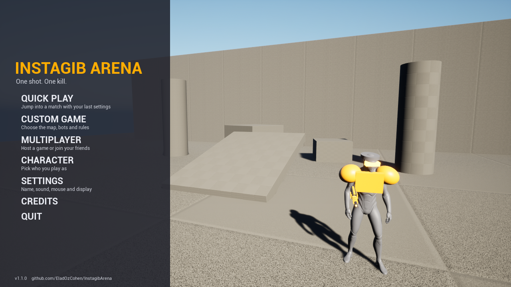
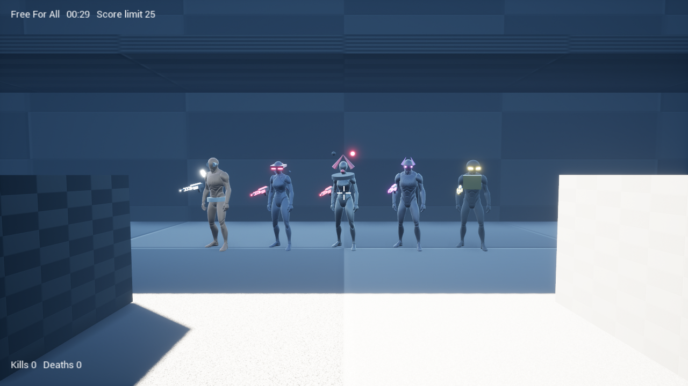
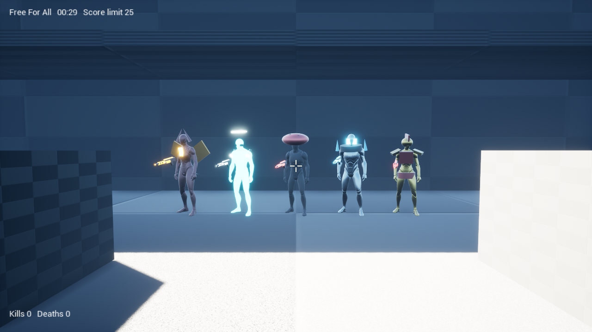

# Instagib Arena

A fast first-person arena shooter in the spirit of Unreal Tournament 2004, built with Unreal Engine 5.8.
One weapon, one hit, one kill.



**Easiest way to get the game, with pictures and step by step help (English and Hebrew): [eladozcohen.github.io/InstagibArena](https://eladozcohen.github.io/InstagibArena/)**

## Download and play (Windows)

You do not need to know anything about code.

1. Open the **[Releases page](../../releases/latest)** and download **`InstagibArena_Setup_1.2.0.exe`**.
2. Run it and follow the wizard. It installs the game and everything the game needs
   (the Microsoft Visual C++ runtime, and optionally a Windows Firewall rule so friends can join your games).
3. If Windows shows a blue "Windows protected your PC" screen, click **More info** and then **Run anyway**.
   The installer is not code-signed, so Windows does not know the publisher yet.
4. Start **Instagib Arena** from the desktop icon or the Start menu.

Requirements: Windows 10 or 11 (64-bit) and a graphics card that supports DirectX 12.

### עברית - בקצרה
1. נכנסים לעמוד **Releases** ומורידים את `InstagibArena_Setup_1.2.0.exe`.
2. מפעילים ועוברים על אשף ההתקנה. הוא מתקין את המשחק ואת כל מה שהוא צריך.
3. אם Windows מציג מסך כחול - לוחצים **More info** ואז **Run anyway** (ההתקנה לא חתומה דיגיטלית).
4. פותחים את **Instagib Arena** מהסמל בשולחן העבודה.

### Playing with friends
- **Same network (home Wi-Fi):** one player opens **Multiplayer > Host a game** and clicks **Host game**. The screen
  shows the address to give to friends. They open **Multiplayer > Join a game**, type it and click **Join game**.
  If a connection fails or is lost, the menu says so on the Join screen.
- **Over the internet:** the easiest way is for everyone to install the free [Tailscale](https://tailscale.com/)
  or [ZeroTier](https://www.zerotier.com/) and join the same virtual network, then use the host's address there.
  Or the host forwards UDP port **7777** on their router.

## What is in the game

- **Instagib** rifle: hitscan, one hit kills. Glowing beams, spark bursts, a hit marker and kill messages.
- **UT-style movement:** double jump, dodge (double-tap a direction), wall dodge, crouch and a slow walk. Smooth camera with head bob, a lean when strafing and a dip on landing (each can be switched off in the settings).
- **Animated characters:** walking and running in eight directions, jump, fall and crouch poses, the rifle in the hands, and a body that collapses when it is hit. Scorch marks stay on walls and floors.
- **A complete match:** a 5 second warm-up with a 3-2-1 countdown, live play, a results screen (rank, kills, deaths, accuracy, best streak) and a quick rematch. Medals for multi-kills, killing sprees and first blood, a kill feed, and a short protection after you respawn.
- **Free for all** and **team deathmatch** (red vs blue), with a score limit, a time limit, or both.
- **Bots** (2 to 10) at three skill levels: beginner, intermediate and expert.
- **15 characters** with their own looks, picked in a menu with a live 3D preview.
- **8 maps:** Foundry (industrial), Sunken Temple, Orbital Dock, Skyline (rooftops, falling kills), Neon Street (night city duel),
  Forge (lava), Glacier (ice) and Canyon (huge, with jump pads to the spires).
- **Online multiplayer** for you and your friends (host a game, others join by address).
- **Sound and music:** footsteps, weapons, hit feedback and three music tracks, with volume settings.
- **A proper main menu:** Quick Play, Custom Game, Multiplayer (host or join, with your address shown), Character
  with a 3D preview, Settings in tabs (gameplay, video, audio, controls), Credits, and a pause menu
  during matches. It works with the mouse and the keyboard, and remembers your choices.
- **Settings you would expect:** rebind every key, four crosshair styles with colour and size, field of view, mouse
  sensitivity, display mode and resolution (with a "keep these settings?" countdown), VSync, frame limit, quality, UI scale,
  volumes, and camera comfort options.

| | |
|---|---|
|  |  |

| | |
|---|---|
|  |  |
|  |  |
|  |  |
|  | |
|  |  |

### Controls

| Key | Action |
|---|---|
| W A S D | Move |
| Mouse | Look |
| Space | Jump (press twice for a double jump) |
| Double-tap W / A / S / D | Dodge |
| Dodge next to a wall in the air | Wall dodge |
| Left Ctrl (hold) | Crouch |
| Left Shift (hold) | Slow walk (quiet and precise) |
| Left mouse button | Fire |
| Tab | Scoreboard |
| Esc | Pause menu (resume, settings, leave the match, quit). In the main menu: back one screen |

## For developers

### What you need
- Unreal Engine **5.8** (Epic Games Launcher)
- Visual Studio 2022 with the **Game development with C++** workload
- Optional: [Inno Setup 6](https://jrsoftware.org/isinfo.php) to build the installer

### Get the project running
```powershell
git clone https://github.com/EladOzCohen/InstagibArena.git
cd InstagibArena

# Epic's Mannequin characters are not stored in this repo (they are part of Unreal Engine's content).
# This copies them from your own Unreal Engine install:
powershell -ExecutionPolicy Bypass -File Tools\restore_mannequins.ps1
```
Then open `InstagibArena.uproject` (or build `InstagibArenaEditor` for Win64 with Visual Studio) and press Play.
The game starts on the main menu.

### Project layout
| Folder | What is there |
|---|---|
| `Source/InstagibArena` | All game code (C++): movement, weapon, game modes, bots, menu, audio, effects |
| `Content/Maps` | The four maps and the main menu level |
| `Content/Audio` | Sound effects and music (generated, see below) |
| `Content/Characters` | The character material; the Mannequins are restored by the script above |
| `Tools` | Python and PowerShell tools that build maps, audio and the installer |
| `Tools/installer` | The Inno Setup script of the installer |

### Tools
- **Sound and music** are synthesized from scratch by `Tools/gen_audio.py` (standard library only), then imported with
  `Tools/import_audio.py`. Nothing is sampled, so there are no licensing questions.
- **Maps** are built by scripts (`Tools/make_map_*.py`, helpers in `Tools/mapkit.py`) run headless with
  `UnrealEditor-Cmd.exe InstagibArena.uproject -ExecutePythonScript=Tools/make_map_temple.py -unattended -nullrhi`.
- **Character look** is defined in `Source/InstagibArena/IACharacterRoster.h` (colors and attached parts per character).
- **Game options** travel in the map URL, for example
  `/Game/Maps/DM-Temple?Mode=TDM?ScoreLimit=30?TimeLimit=10?Bots=6?BotSkill=2?Char=4`.
- **Build the Windows package and the installer:** `powershell -File Tools\package_and_installer.ps1`.
- **Testing without a screen:** `IADevSubsystem` adds command-line options for development builds, for example
  `-IAShotDelay=20 -IAShotName=test` (screenshot and quit), `-IAReport` (log what a machine sees, for comparing a host and a client),
  `-IAWalk`, `-IAFireEvery=2`, `-IAShowroom=X,Y,Z,Yaw` and `-IAPreviewCycle`.

### Mac
Nothing in the code is Windows-specific, but a Mac build has to be made on a Mac with Xcode.

## Credits and licenses

- Game code, tools and generated audio: MIT, see [LICENSE](LICENSE). More in [NOTICE.md](NOTICE.md).
- Built with **Unreal Engine** by Epic Games. The Mannequin characters and animations are Epic's content and are used under
  the Unreal Engine EULA; they ship inside the game builds but are not stored in this repository.
- Third-party notices of the game build are in `NOTICES.txt` in the installed game folder.
